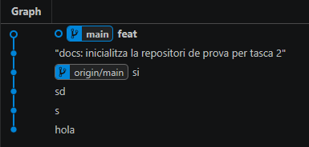
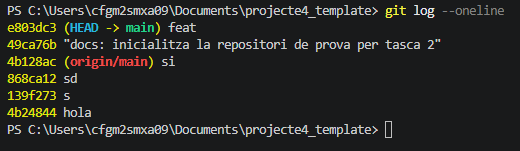
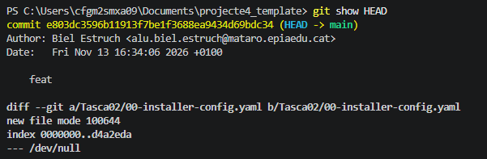
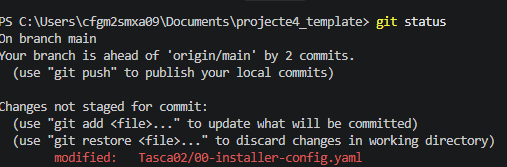
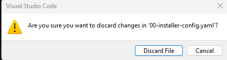
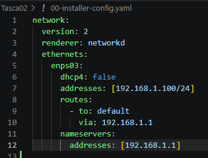
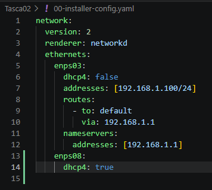

En aquesta activitat treballarem un aspecte fonamental de control de versions: l'historial de versions. Veurem com podem viatjar en el temps dins del nostre repositori i recuperar versions anteriors dels fitxers.

Observa l'historial del teu repositori amb l'historial detallat, identificant la informació disponible per cada commit

Compara el resultat amb l'historial resumit, executant a la terminal la comanda

Inspecciona els canvis exactes del darrer commit amb la comanda:

Simularem un error humà editant el fitxer 00-installer-config.yaml

Desfem els canvis del fitxer interficies.yaml i tornem-lo a l'estat del darrer commit. Això es pot fer gràficament a l'editor VS Code, fent clic amb el botó dret sobre el fitxer i seleccionant l'opció "Discard changes". També es pot fer des de la terminal amb la comanda.git restore 00-installer-config.yaml

Editarem l'arxiu 00-installer-config.yaml i modificarem el valor de dhcp4 a false i afegirem una un configuració estàtica a la interfície enps03

Editem de nou l'arxiu, ara per configurar una segona interfície enps08 en mode DHCP:

