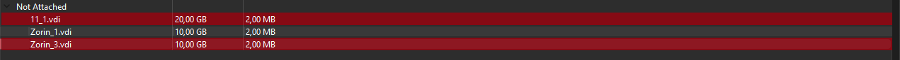
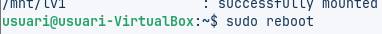

## Configuració Inicial: Crear un grup de volums (VG) i un volum lògic (LV) utilitzant inicialment un mínim de dos discs durs de 10 GB de capacitat. Aquest volum haurà estar formatat i muntat automàticament al sistema mitjançant l’edició de l’arxiu /etc/fstab.

Primer vaig anar a VirtualBox, a l'apartat d'emmagatzematge, i vaig afegir dos discos durs de 10 GB. Després vaig iniciar Ubuntu i vaig instal·lar LVM2 amb la comanda sudo apt install lvm2 -y.

A continuació, vaig preparar els dos discos amb pvcreate i els vaig agrupar en un grup de volums anomenat vg1 amb vgcreate. Dins d'aquest grup vaig crear un volum lògic anomenat lv1 utilitzant tot l'espai disponible.

Després vaig formatar el volum en ext4 amb mkfs.ext4 i vaig crear la carpeta /mnt/lv1 per muntar-lo.

Finalment, vaig editar el fitxer /etc/fstab i hi vaig afegir la línia corresponent per fer que el volum es muntés automàticament cada vegada que s'iniciés Ubuntu. Després de reiniciar la màquina, el volum continuava muntat correctament.

He afegit dos discos durs nous de 10 GB a la màquina virtual per poder crear un mirall LVM. Després els he preparat com a volums físics i els he afegit al grup de volums vg1 per tenir espai suficient i poder crear el volum lvm_mirror, que permet duplicar les dades en dos discos.