## Configuració Inicial: Crear un grup de volums (VG) i un volum lògic (LV) utilitzant inicialment un mínim de dos discs durs de 10 GB de capacitat. Aquest volum haurà estar formatat i muntat automàticament al sistema mitjançant l’edició de l’arxiu /etc/fstab.

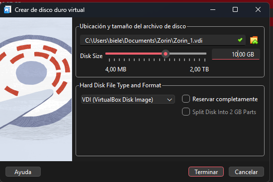

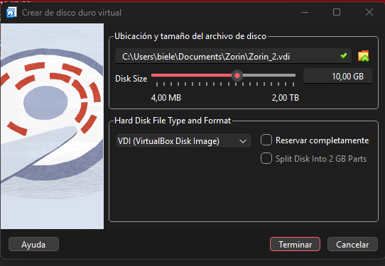

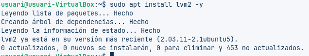

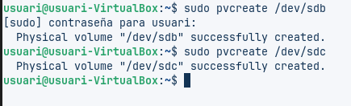

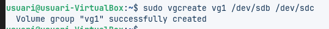

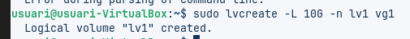

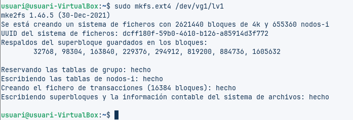

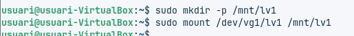

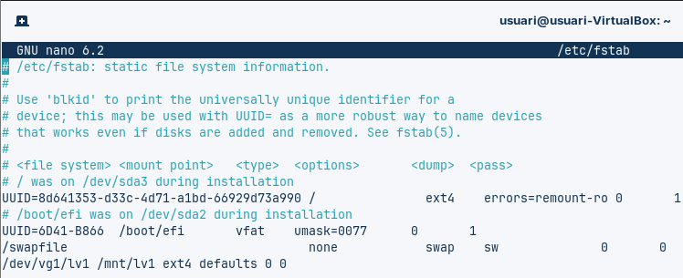

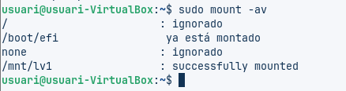

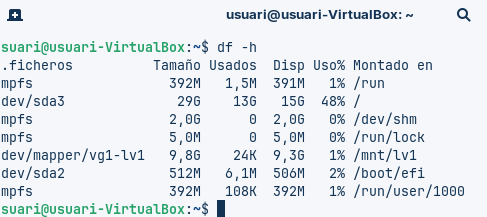

Primer vaig anar a VirtualBox, a l'apartat d'emmagatzematge, i vaig afegir dos discos durs de 10 GB. Després vaig iniciar Ubuntu i vaig instal·lar LVM2 amb la comanda sudo apt install lvm2 -y.

A continuació, vaig preparar els dos discos amb pvcreate i els vaig agrupar en un grup de volums anomenat vg1 amb vgcreate. Dins d'aquest grup vaig crear un volum lògic anomenat lv1 utilitzant tot l'espai disponible.

Després vaig formatar el volum en ext4 amb mkfs.ext4 i vaig crear la carpeta /mnt/lv1 per muntar-lo.

Finalment, vaig editar el fitxer /etc/fstab i hi vaig afegir la línia corresponent per fer que el volum es muntés automàticament cada vegada que s'iniciés Ubuntu. Després de reiniciar la màquina, el volum continuava muntat correctament.

## Alta Disponibilitat: Implementar la configuració d’un mirall (lvm_mirror) que protegeixi la informació davant la fallada d'un disc.

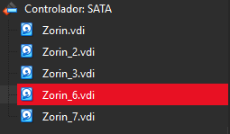

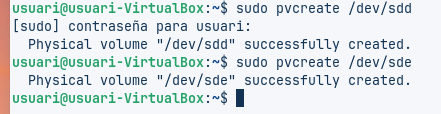

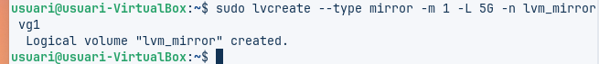

He afegit dos discos durs nous de 10 GB a la màquina virtual per poder crear un mirall LVM. Després els he preparat com a volums físics i els he afegit al grup de volums vg1 per tenir espai suficient i poder crear el volum lvm_mirror, que permet duplicar les dades en dos discos.

## Instantànies (snapshots): Crear i afegir dos discos de 10 GB al grup de volums. Crear un volum (lvm_dades) amb el primer disc afegit, formatar-lo i muntar-lo. A continuació afegir arxius al volum (poden ser imatges d’Internet). Usar el segon disc afegit per crear un snapshot (lv_snapshot) i documentar com es pot restaurar aquest snapshot, si per exemple, la informació del volum original es danyés.

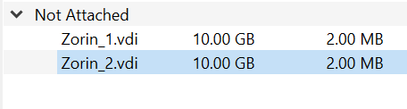

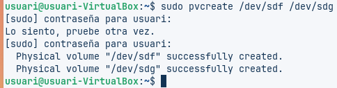

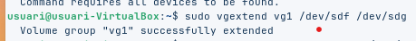

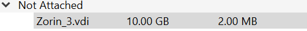

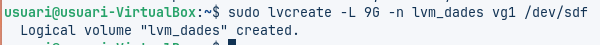

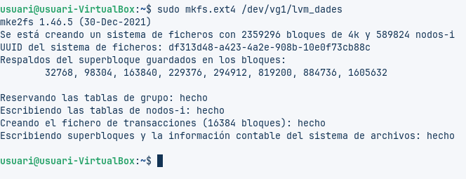

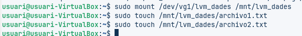

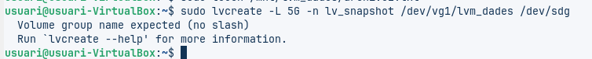

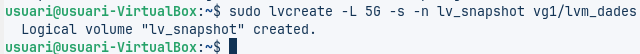

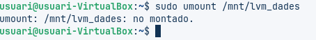

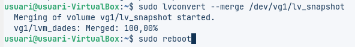

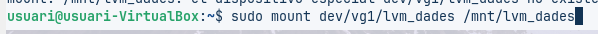

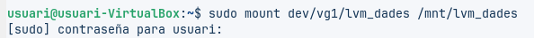

He afegit dos discos durs de 10 GB al grup de volums vg1. Després he creat el volum lògic lvm_dades amb el primer disc, l'he formatat i muntat. He afegit alguns fitxers i he utilitzat el segon disc per crear una instantània anomenada lv_snapshot, que permet recuperar les dades al seu estat anterior si es fan malbé.

## scalabilitat: Demostrar el procés d'ampliació. Usar l’espai que quedi lliure dins el grup de volums per ampliar el volum lv_dades.

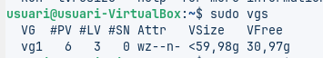

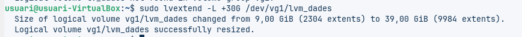

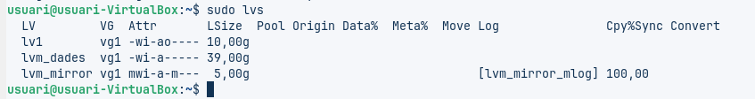

He ampliat el volum lògic lvm_dades utilitzant 30 GB de l'espai lliure del grup de volums vg1. D'aquesta manera, he augmentat la capacitat del volum de 9 GB a 39 GB sense haver de crear-ne un de nou.

# Espais d'emmagatzematge a Windows 11
## S'ha d'utilitzar Windows 11 per demostrar les configuracions possibles mitjançant els Espais d'Emmagatzematge (Storage Spaces).

## Requisits de la Implementació i Demostració:

## Configuració inicial: Creació d'un Storage Pool: Crear un pool d'emmagatzematge inicialment amb tres discos de 10 GB (simulats).

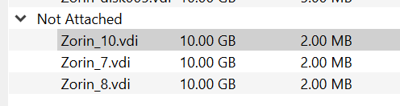

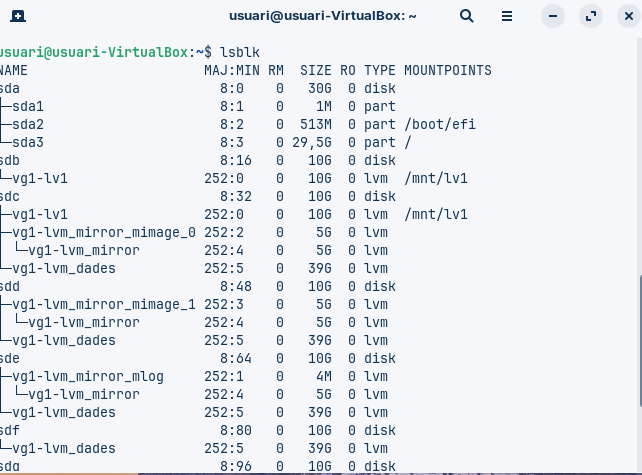

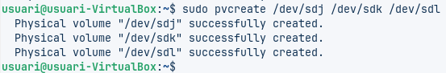

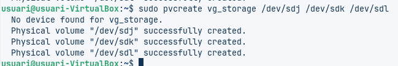

## Estudi de Configuracions: Demostrar i documentar la creació d'un Espai d'Emmagatzematge utilitzant:- Resiliència de Mirall (Mirroring): Usar dos dels discos. Comprovar que ofereix alta disponibilitat.
## - Resiliència de Paritat (Parity): Explicant la seva eficiència d'espai en comparació amb el mirall. Cal usar els tres discos.
## - Resiliència de mirall triple. Afegir tant discos de 10 GB com siguin necessaris.

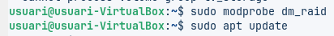

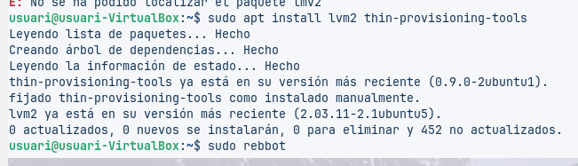

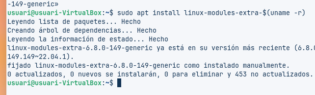

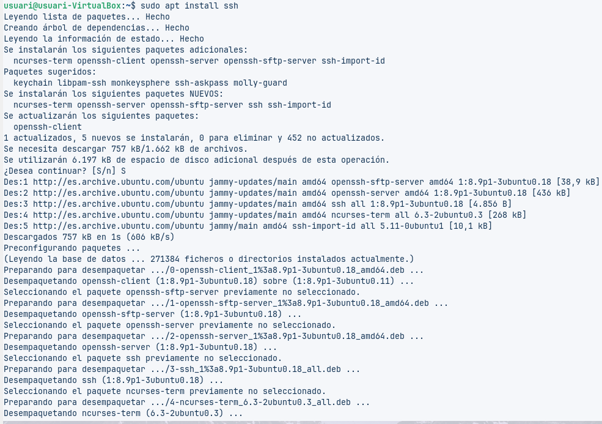

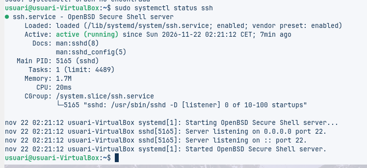

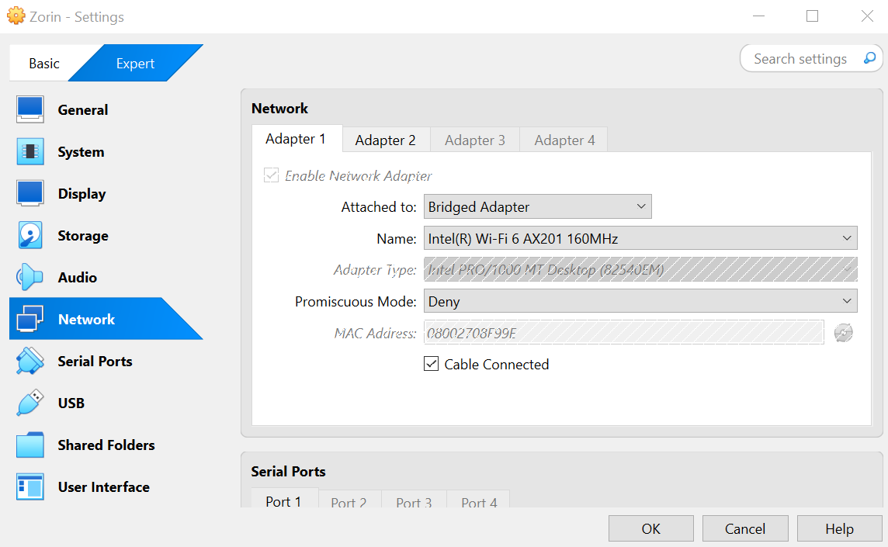

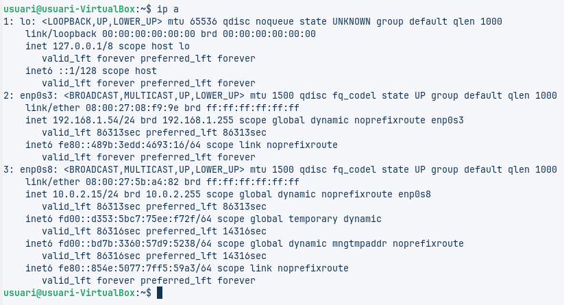

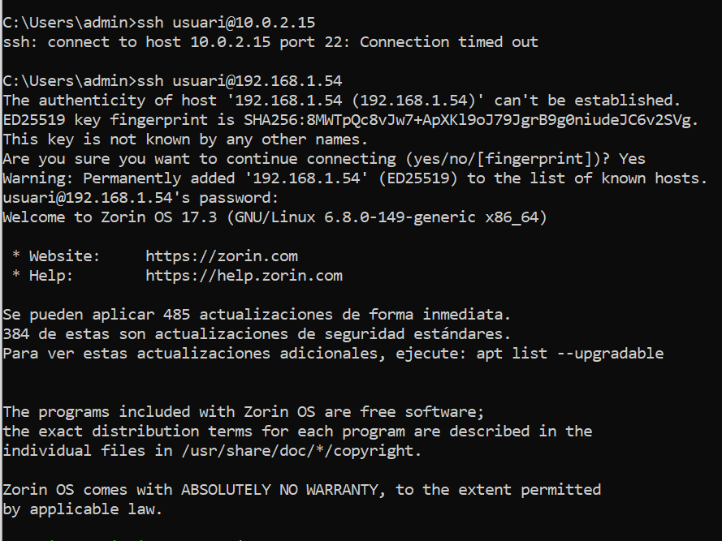

