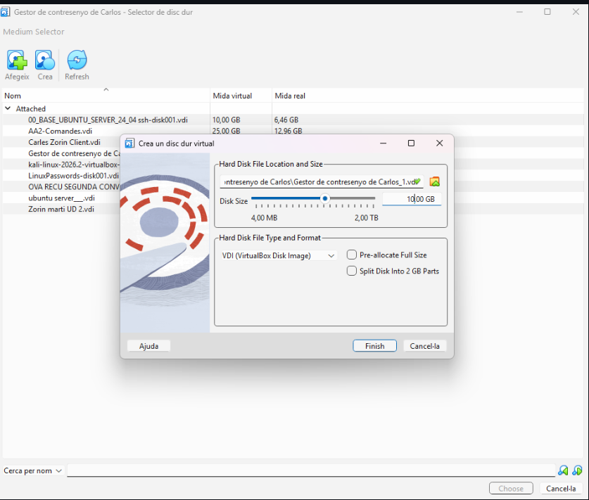
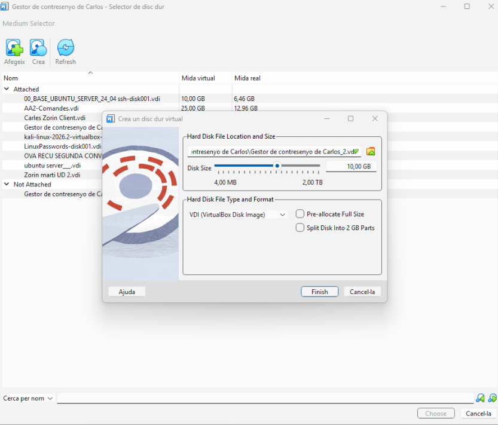
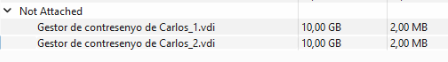
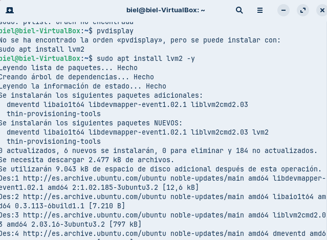
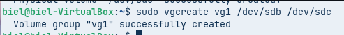
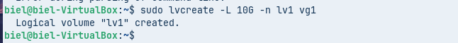
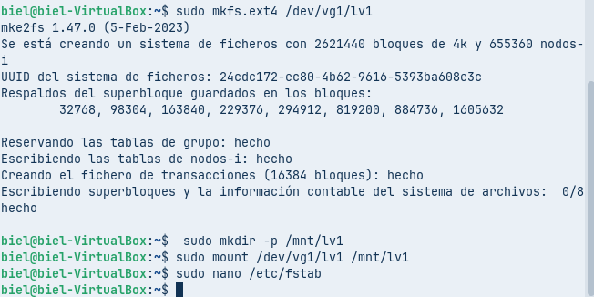
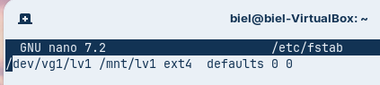

## Configuració Inicial: Crear un grup de volums (VG) i un volum lògic (LV) utilitzant inicialment un mínim de dos discs durs de 10 GB de capacitat. Aquest volum haurà estar formatat i muntat automàticament al sistema mitjançant l’edició de l’arxiu /etc/fstab.

Creo els discs de 10 GB intalo el Lvms2 instalo lvm2 i creo el volums fisics i creo un grup de volums amb els dos discos i un volum lògic anomenat lv1 utilitzant tot l'espai disponible i formatego el volum amb el sistema de fitxers ext4 i creo el directori on muntarem el volum